<div align="center">

# 🪨 claude-pbr-texture-agents

**Turn a PBR texture set - or even a single albedo image - into a finished material presentation.**<br>
Seven [Claude Code](https://claude.com/claude-code) subagents and three skills driving headless Blender (Cycles), Python and Pillow.


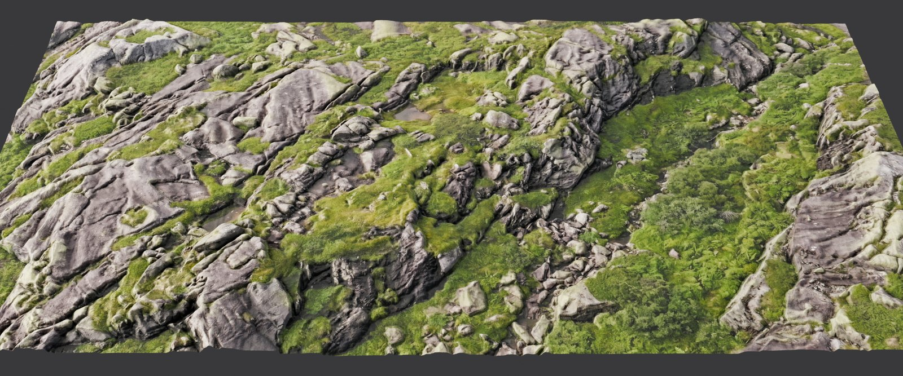

<sub>A moss-and-rock plane with real displaced geometry, rendered in Cycles on the neutral grey series look. Example images: see [Credits](#credits-and-example-images).</sub>

</div>

---

## ✨ What you get

| | |
|---|---|
| 🌐 **Ball** | a hemisphere-projected sphere (no triplanar lumps, no pole pinching) |
| 🏞️ **Plane** | real displaced relief from the height map, tiled or single scan |
| 📷 **Series stills** | neutral-grey ball, equator, plane and macro close-up, 4K on request |
| 💾 **Scene per stage** | a `.blend` after every stage so you can inspect the process |
| 📦 **Optional exports** | GLB (plane + ball), seamless turntable MP4 |
| 🧾 **Presentation** | a "texture-guide" sheet, a social thread and a work summary |

<table>
<tr>
<td width="50%">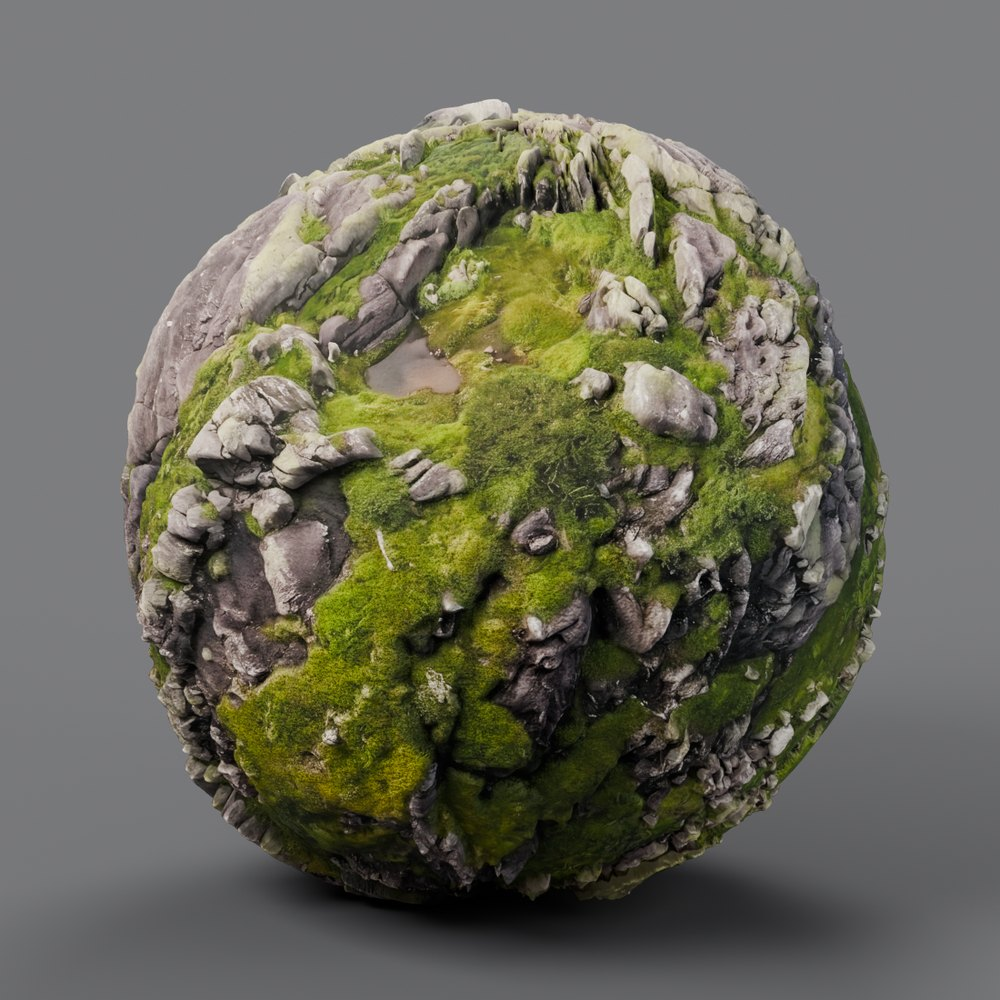<br><sub><b>Ball</b> - hemisphere projection, baked maps</sub></td>
<td width="50%">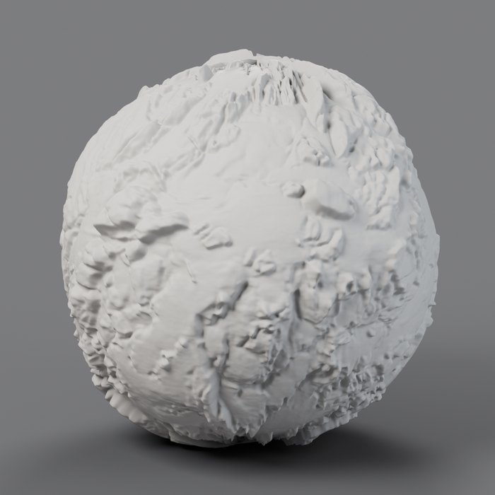<br><sub><b>Clay check</b> - the geometry alone, before any colour</sub></td>
</tr>
</table>

<p align="center">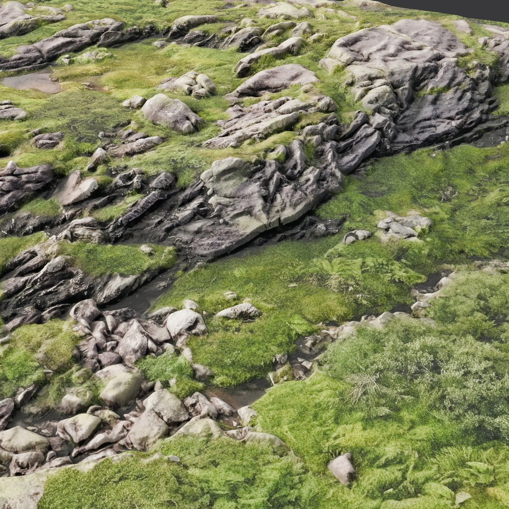<br><sub><b>Close-up</b> - real geometry, not just a normal map</sub></p>

## 🗺️ Maps in, presentation out

Example maps of the set used for the images above (resized previews):

<table>
<tr>
<td width="20%">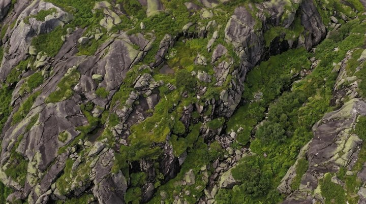</td>
<td width="20%">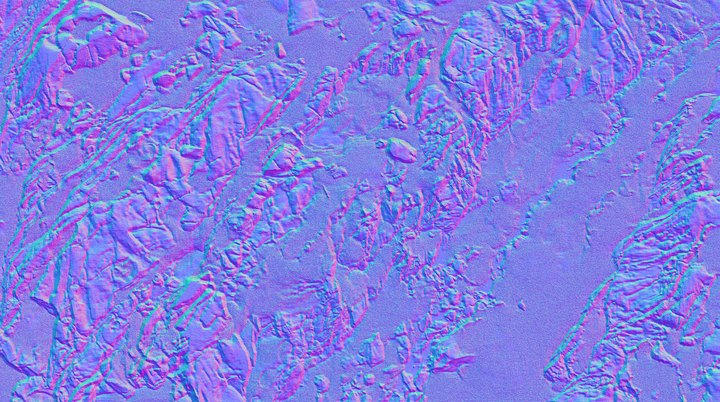</td>
<td width="20%">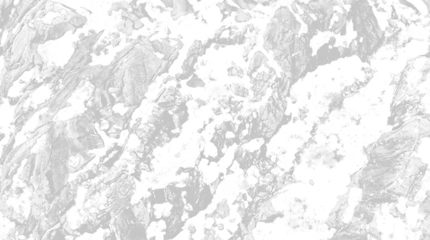</td>
<td width="20%">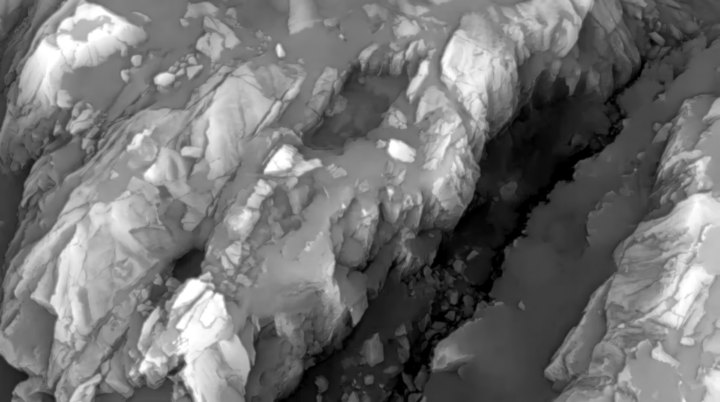</td>
<td width="20%">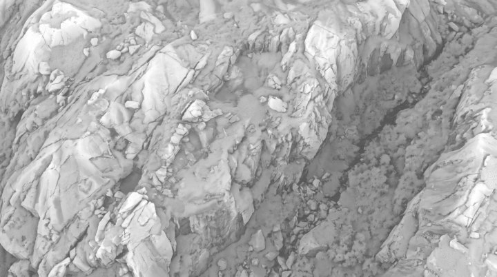</td>
</tr>
<tr align="center">
<td><sub><b>Albedo</b><br>sRGB</sub></td>
<td><sub><b>Normal</b><br>OpenGL, non-colour</sub></td>
<td><sub><b>Roughness</b><br>non-colour</sub></td>
<td><sub><b>Height</b><br>16-bit</sub></td>
<td><sub><b>AO</b><br>non-colour</sub></td>
</tr>
</table>

## 🔁 How it works

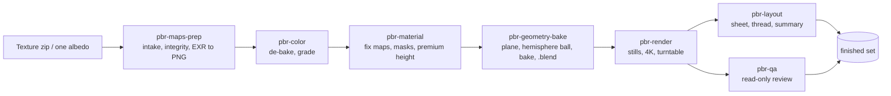

<p align="center">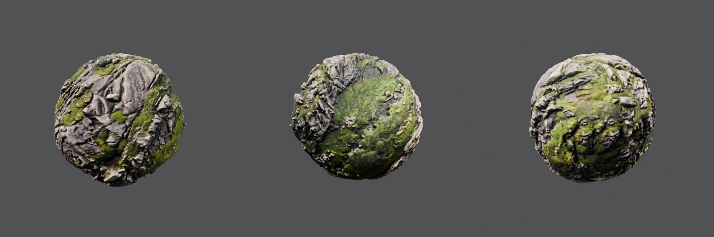<br><sub><b>GLB check</b> - the exported ball reloaded and rendered from three sides</sub></p>

## What is inside

```
agents/                      Claude Code subagents (copy to ~/.claude/agents)
  pbr-maps-prep.md           intake: unzip, integrity, EXR->PNG, tileability, compare with previous set
  pbr-color.md               albedo colour: baked-shadow measurement, de-baking, grading
  pbr-material.md            maps: fix/soften, masks, premium height, inferred or procedural maps, quilting
  pbr-geometry-bake.md       plane mesh, hemisphere ball atlas, bake, .blend scenes, optional GLB
  pbr-render.md              look-dev, stills, 4K, turntable (the only agent allowed to use the GPU)
  pbr-layout.md              texture-guide sheet, social thread, summary
  pbr-qa.md                  read-only reviewer
skills/                      Claude Code skills (copy to ~/.claude/skills)
  pbr-material-pipeline/     the coordinator workflow and hard-won rules
  pbr-lookdev-render/        the neutral series look and render rules
  pbr-texture-sheet/         the sheet layout
docs/img/                    example previews used in this README
install.sh                   copies agents and skills into ~/.claude
```

## 🚀 Install

```bash
git clone git@github.com:mukadeshinigami/claude-pbr-texture-agents.git
cd claude-pbr-texture-agents
./install.sh          # copies into ~/.claude/agents and ~/.claude/skills (asks before overwriting)
```

Restart Claude Code, then ask for example: *"build the scene as usual from ~/Downloads/rock_4k.zip"*. Claude loads the `pbr-material-pipeline` skill, asks once whether you want a `.blend` after every stage, and spawns the specialists.

## What you need on your machine

- Blender 4.x with Cycles (headless: `blender -b -P script.py -- args`); an NVIDIA GPU with OptiX is assumed for rendering, CPU works but is slow.
- Python 3 with numpy, scipy, Pillow and OpenCV (run scripts with `python -I`).
- ffmpeg for turntables.
- A project folder with `assets/`, `scripts/`, `models/`, `renders/`. The agents write their own scripts per project; they are not shipped here.

## 📏 Rules baked into the agents

- Ball = hemisphere projection from the pole. **Triplanar/box projection is never used** (it creates crossing layers that read as lumps). Cube = per-face UV crops. Plane = plain UV.
- A `.blend` scene is saved after every stage; heavy renders only after the user has seen it; GLB only if the user says yes at the end.
- Honest labelling: "stylised, not a scan" for procedural maps, "inferred" for maps derived from a single image, resample vs AI detail stated, stand-in maps declared.
- De-bake check on every albedo (correlation of luminance with height > 0.7 = shading painted into the colour).
- Source licences matter: many free packs forbid redistribution; derived maps are still derivatives, so credit the source.

## Notes

The agents were developed on Linux (Arch) with Blender and a mid-range RTX card; adjust paths and the GPU etiquette in `pbr-render.md` for your setup.

## Credits and example images

The example images in `docs/img/` are small preview renders and resized map thumbnails of a third-party rock-and-moss texture set (a scan-based 16K set; the archive did not state its origin or licence). They are included only to show what the pipeline produces and are not a redistribution of the maps. If you are the rights holder and want them removed, open an issue.
